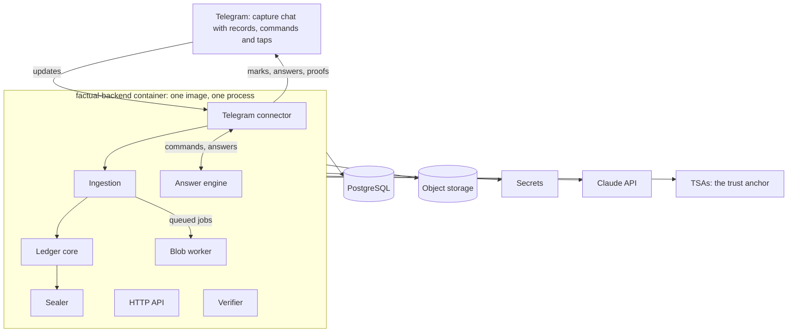

# Factual — Technical Specification

21 November 2026 · Greg Nagy

Companion file: `PROJECT_PLAN.md` lists the user stories that implement this specification, in order of work.

## Summary

Factual turns what you send to one Telegram chat into tamper-evident evidence and finds it again when you ask. Its bot, Thoth, records every message and attachment in an append-only, hash-chained ledger, seals the ledger every 5 minutes with a trusted timestamp, and files each record under a project that you pick with one tap.

**Main goal:** record and find evidence fast. These targets are the test for every design choice.

| Step | Target |
| --- | --- |
| A message is recorded and marked with ✍ | 2 seconds after Telegram delivers it |
| A record is filed under a project | 1 tap |
| An entry is sealed with a trusted timestamp | 5 minutes |
| `/ask` shows the matching records | 2 seconds |
| `/ask` adds Claude's verdict | 15 seconds |

- **Capture.** Send text, photos, files, voice notes or forwarded messages to the Factual chat. Thoth records each one within seconds and marks it with ✍.
- **Projects.** Each record is filed under a project such as `family` or `client-acme`: tap the project under the record, or pick it first with `/log`.
- **Integrity.** Entries are hash-chained and sealed every 5 minutes: the chain head is signed and timestamped by external RFC 3161 time-stamping authorities (TSAs).
- **Recall.** `/ask did Greg say the kickoff is on 5 February?` shows the matching records as verbatim quotes, then Claude adds a one-line verdict.
- **Proof.** `/proof` builds an evidence pack that anyone can verify offline, so you can present a record anywhere, even in person.
- **Response.** `/respond` tests a claim against the records and drafts a calm, evidence-only reply for you to edit and send.

**In v1 (roadmap phases 0–2):** one Telegram capture chat; text, photos, documents, voice, video and forwarded messages; edits; projects; `/log`, `/ask`, `/proof`, `/verify` and `/respond`; the daily help message; a read-only HTTP API. **Not in v1:** a frontend, Slack and other connectors, roles and consent, erasure of single records, voice transcription and vector search.

## Decisions

These decisions of 21 November 2026 closed all open questions; the rest of this specification follows them.

| Topic | Decision |
| --- | --- |
| Purpose of the chat | The Telegram chat only captures records and recalls them. Debate and consent happen elsewhere, for example in person with an evidence pack |
| Consent | No consent model. People post their records on purpose |
| One-to-one chats | Not captured. A group chat is enough |
| AI | Claude, through the Claude API. No local models and no choice of provider |
| Chats and projects | One capture chat serves all projects. A record gets its project by a tap |
| Rights | Everyone in the capture chat can use every command and every project |
| Language | English only, for search and for drafts |
| Retention and erasure | No erasure workflow. Records stay, and attachments are locked for a set period |
| Witness posts | None. The TSA tokens anchor the seals |
| Reactions | Not captured. Thoth's own ✍ mark stays |
| Hosting | Not prescribed. Factual ships as a container that runs anywhere |
| Names | The project is Factual and the bot is Thoth |

One consequence follows from the single chat: a project is now a label, not a separate ledger. Every message is recorded and sealed at once, and choosing the project only files it.

## Design principles

Seven rules decide the trade-offs. Two matter most: capture and search stay fast, and trust is anchored outside the operator's reach.

1. **Fast and simple first.** Recording takes one message and filing takes one tap. Each job has one mechanism: one chat, one ledger, one seal, one search index.
2. **Record first, file later.** A message is recorded and sealed as soon as it arrives. Its project is a label added by a later entry, so a late or changed choice never delays or alters the record.
3. **Raw before interpreted.** The raw platform payload is stored exactly as received. Normalised fields, extracted text and Claude's answers are derived data and never replace it.
4. **Append-only.** Nothing recorded is updated or deleted. Edits, project choices and answers are new entries that reference older ones.
5. **Trust lives outside the database.** Whoever runs the database could rewrite it, so the database alone proves nothing. Seals are signed and timestamped by third parties, which makes a rewrite detectable.
6. **Claude selects, the system quotes.** Claude picks evidence IDs and writes a one-line verdict. Quotes, names, times and verification status come straight from the ledger.
7. **Verifiable without the system.** Evidence packs use open formats (JSON, SHA-256, Ed25519, RFC 3161) and verify offline with standard tools.

## Core concepts

Factual has one capture chat and one ledger; a project is a label that groups records.

| Concept | What it is | Example |
| --- | --- | --- |
| Capture chat | The one private Telegram group that Thoth serves. Everything sent there is a record or a command | A group named "Factual" with you, your partner and Thoth |
| Record | One message sent to the capture chat, with its attachments: a note, a photo, a file, a voice note or a forwarded message | "Greg called. He may move the kickoff to 12 February" |
| Project | A label that groups records. Its name is short and permanent | `family`, `personal`, `employer`, `client-acme` |
| Ledger entry | One immutable row in the ledger: a record, an edit, a stored attachment, a project choice or an answer | E41233, a `record.created` entry |
| Seal | A signed, externally timestamped commitment to every entry up to a number | Seal 482 covers entries 1–41240 |
| Evidence pack | A zip of selected entries, attachments, proofs and seals, with a verifier that runs offline | `proof-E41233.zip` |
| Derived content | Text that Claude reads from images and PDFs; used for search, never treated as evidence | The text of a photographed letter |
| Connector | A plugin for one chat platform | Telegram, through the bot Thoth |

The ledger is one chain for the whole instance, so an entry's ID is simply its number, such as E41233. Choosing or changing a record's project adds an entry and never touches the record.

## Trust model

A verified record proves that its content existed at a known time and has not changed since. It does not prove that a note is true, so Factual keeps the strongest form of each record and shows its origin.

**What a verified record proves**

1. **Existence and content:** entry E41233 with this exact content existed no later than the time in the TSA token of the seal that covers it.
2. **Integrity:** nothing in the ledger was altered, removed, reordered or inserted between seals.
3. **Capture:** Telegram reported that account 51234567 sent this message to the capture chat at time t.
4. **Forward origin:** for a forwarded message, Telegram supplies the original send time and the original sender.

**What it cannot prove:** that a note describes an event correctly, that a screenshot was genuine before it was sent, or who typed a message on an account. Forward origin has a limit: when the sender hides their account, Telegram gives only a display name.

> A hash chain stored in the same database as the data only stops people who cannot recompute it. Whoever controls the database, including you, could rebuild a consistent fake chain. Third-party timestamps on the seals are what make the record convincing to the other side of a debate.

| Threat | Actor | Detected or prevented by |
| --- | --- | --- |
| Edit a stored record | Anyone with database access | Payload hash no longer matches the entry's commitment |
| Delete, insert or reorder entries | Database admin | The chain no longer matches the sealed chain head |
| Rewrite the whole ledger consistently | Operator | Earlier seals no longer match, and a new seal can only carry a later TSA time |
| Backdate a fabricated record | Operator | Impossible once sealed: a new entry can only get a later timestamp |
| Record a false or late note | Member | Not prevented: a record proves when it was written, not that it is true; answers show its author and origin |
| Swap an attachment in storage | Storage admin or attacker | SHA-256 mismatch on retrieval; Object Lock blocks overwrite and delete |
| Edit a message after sending it | Member | The edit is a new entry; the first version stays on record |
| Delete a message in Telegram | Member | The record stays, because Telegram does not report group deletions to bots |
| Misquote or invent evidence | Claude | Quotes are rendered from the ledger, never generated; every verdict must cite entry IDs |
| Prompt injection through record text | Member or forwarded text | Record text is passed as data, tools are read-only and output is schema-checked |

This is weaker than a signed contract but far stronger than screenshots: each claim can be checked by someone who does not trust the operator.

## Architecture

Factual runs as one container: a FastAPI process that also runs the Telegram connector, the workers and the sealer. All state lives in PostgreSQL and object storage, so the container can be replaced at any time.



| Component | Where | What it does |
| --- | --- | --- |
| Telegram connector | Container | Thoth; long polling; acknowledges Telegram only after the commit; sends ✍ marks and replies |
| Ingestion | Container | Canonicalises (JCS), hashes and appends, queues file jobs |
| Ledger core | Container | Hash chain, salted commitments, insert-only tables |
| Sealer | Container | Seals every 5 minutes with an Ed25519 signature and TSA timestamps |
| Answer engine | Container | Search hits first; Claude picks IDs; quotes come from the ledger |
| Blob worker | Container | Downloads files at once, hashes and encrypts them, uploads with a lock |
| HTTP API | Container | FastAPI on port 8000: health, version and the read-only `/api/v1` routes |
| Verifier | Container | Checks each answer, runs the nightly deep audit, builds proof packs |
| PostgreSQL | Outside | Ledger, payloads, seals, job queue |
| Object storage | Outside | S3 with Object Lock; encrypted files |
| Secrets | Outside | Signing key and master key |
| Claude API | Outside | Verdicts and drafts; receives snippets only |
| TSAs | Outside | RFC 3161 tokens, two per seal |

Records flow from the Telegram connector through ingestion and the ledger core to the sealer, and everything people see leaves through the Telegram connector. The TSAs are the trust anchor: nobody who runs the container can rewrite their timestamps.

## Capture and integrity

Every message sent to the capture chat becomes a ledger entry in one database transaction before Telegram is acknowledged. The entries form one hash chain, which is sealed every 5 minutes.

What the brief calls a rolling hash is a **hash chain** here: each chain value is computed from the one before it and the new entry.

### Ledger entry

```json
{
  "v": 1,
  "seq": 41233,
  "type": "record.created",
  "source": {"connector": "telegram", "chat_id": -1001234567890,
             "message_id": 8812, "update_id": 553201177},
  "observed_at": "2026-10-29T13:03:12Z",
  "received_at": "2026-10-29T13:03:13.418Z",
  "payload_commitment": "sha256:9f3a…",
  "refs": []
}
```

- `entry_hash = SHA-256("ledger-entry-v1" ‖ JCS(entry))`. JCS is the JSON Canonicalization Scheme (RFC 8785), so the same entry always hashes to the same bytes. Canonical bytes are stored as `bytea`, never as `jsonb`, which reorders keys.
- `observed_at` is the platform time: Telegram's `date` or `edit_date`, set by Telegram's servers. `received_at` is the container's clock and is never trusted on its own.
- `refs` points at earlier entries: the record that an edit, a reply, a project choice or an attachment belongs to.

| Entry type | Written when |
| --- | --- |
| `record.created` | A message arrives in the capture chat |
| `record.edited` | Its author edits the message in Telegram |
| `record.filed` | Someone picks or changes the record's project |
| `attachment.stored`, `attachment.unavailable` | A file is stored, or cannot be fetched |
| `project.created`, `project.archived` | `/project new` or `/project archive` runs |
| `qa.answered` | `/ask` or `/respond` finishes |
| `audit.completed` | A deep audit ends |

### Payload and commitment

The payload holds the raw Telegram update exactly as received, plus a normalised view with the author, the text and the forward origin. It is stored apart from the entry, with a 32-byte random salt:

`payload_commitment = SHA-256(salt ‖ JCS(payload))`

- **Guessing:** short messages such as "ok" cannot be recovered from a commitment inside a proof.
- **Selective disclosure:** one record can be proven to a third party without revealing any other record.

### Hash chain

- `chain_hash(n) = SHA-256("ledger-chain-v1" ‖ chain_hash(n − 1) ‖ entry_hash(n))`. This is the rolling hash: each value depends on every entry before it, and `seq` has no gaps.
- The chain starts from a genesis value: the hash of the instance's public key and its creation time.
- A proof for one entry holds the chain value before it and the hashes of the entries after it, up to the next seal. With a seal every 5 minutes that list is short, and all other entries stay hidden behind their hashes.
- Appends are serialised with one Postgres advisory lock; chat volumes make this a non-issue.
- The application's database role may insert into evidence tables but never update or delete, and a trigger rejects both. This is defence in depth; the seals are the real protection.

### Seals

Every 5 minutes, if there are new entries, the sealer writes:

```json
{
  "v": 1, "no": 482,
  "up_to_seq": 41240,
  "chain_head": "sha256:c3d9…",
  "prev_seal": "sha256:aa02…",
  "created_at": "2026-10-29T13:05:00Z"
}
```

1. **Chain head:** the chain value at the last entry. It commits to every entry so far, in order, and `prev_seal` links the seals to each other.
2. **Signature:** Ed25519 over the canonical seal with the instance key. The public key ships in every evidence pack, and `/status` shows its fingerprint.
3. **Trusted timestamp:** an RFC 3161 request over `SHA-256(seal ‖ signature)` to two independent TSAs. The full tokens and TSA certificate chains are stored.

Two stronger anchors are optional and off by default:

- **Qualified timestamp.** Under eIDAS Article 41(2), a qualified electronic time stamp is presumed accurate in date and time and in the integrity of the bound data; other timestamps stay admissible but carry no such presumption. Qualified stamps are sold per stamp ([Lleida.net](https://mailing.lleida.net/en/esignature-and-econtracting/timestamp) lists them from €0.03), so this setting stamps one seal a day. Because the chain links every entry, that stamp also covers all earlier entries.
- **Bitcoin anchor.** The seal digest is submitted to OpenTimestamps. It is free and needs no trusted party; the proof completes after a few hours.

### Attachments

1. The `record.created` entry lists each attachment's descriptor: Telegram `file_id`, `file_unique_id`, declared size, MIME type and file name.
2. A worker downloads the file immediately with `getFile`. File IDs are tied to one bot token and Telegram may remove media later, so waiting is a risk.
3. The stream is hashed (SHA-256 of the plaintext), encrypted with its own AES-256-GCM key, and hashed again as ciphertext. The file key is stored wrapped by the master key.
4. The ciphertext is uploaded with `x-amz-checksum-sha256`, so the store verifies it on receipt, into a versioned bucket with Object Lock. The object version ID is kept.
5. An `attachment.stored` entry references the record and holds both hashes, size, detected MIME type, object key and version, and the retention date.

The cloud Bot API downloads files up to 20 MB. A larger file gets an `attachment.unavailable` entry, and Thoth says so at once, so the file can be sent again in a smaller form.

### Edits, replies and what is not captured

- **Edits** become `record.edited` entries that reference the record; both versions stay. Telegram also sends edit updates for fields Thoth does not use, so an edit is recorded only when the text, caption or media changed.
- **Replies:** a reply to a record is a new record that references it and takes its project.
- **Albums:** photos sent as one album arrive as separate messages; Thoth waits 2 seconds and stores them as one record.
- **Not captured:** reactions, membership changes, service messages and Thoth's own messages.
- **Deletions** in Telegram are not reported to bots, so a deleted message stays on record.

### Ingestion sequence

1. The connector receives a batch of updates by long polling.
2. Ingestion drops updates from other chats and canonicalises each message.
3. In one transaction it takes the ledger lock, computes the commitment and hashes, inserts the entry, payload and projections, and queues attachment jobs.
4. Only after the commit does the connector advance its Telegram offset and set the ✍ mark. Delivery is at-least-once; a unique key on the update ID drops duplicates.
5. Workers store attachments and append `attachment.stored`.
6. The sealer seals and timestamps on its schedule.

## Verification and evidence packs

Verification runs at three depths: a fast check on every answer, a deep audit every night, and an offline check that anyone can run from an evidence pack.

| Level | When | What is checked |
| --- | --- | --- |
| Fast | Every `/ask` answer and `/verify` | Commitment of each cited entry; chain proof to its seal; seal signature and TSA tokens; attachment checksum from object metadata |
| Deep | Nightly and after any restore | The whole chain against every seal; every signature and token; a full re-hash of every attachment (throttled); TSA certificate status |
| Independent | On demand, by anyone | An evidence pack, checked offline with `openssl` and the bundled verifier, without access to Factual |

Each audit appends an `audit.completed` entry, so the history of checks is itself on record. A failure is posted in the capture chat with the exact entry, seal or object that failed.

**Labels shown with a record.** Each record shows one integrity status and, where it applies, an origin label.

- **Verified** — unchanged since capture; sealed at a stated time by a named TSA.
- **Pending seal** — captured minutes ago and not yet sealed.
- **Failed** — a mismatch was found; the capture chat has the details.
- **Forwarded** (origin) — Telegram supplied the original sender and send time.
- **Imported** (origin, later) — added from a chat export, so weaker than live capture.

### Evidence pack

`/proof` as a reply to a record, or `/proof E41233`, posts a zip in the capture chat:

```text
proof-E41233.zip
├── README.txt                 how to verify, in plain words
├── entries/41233.json         canonical ledger entry
├── payloads/41233.json        payload + salt (disclosed entries only)
├── blobs/3f9c….jpg            decrypted attachment
├── proofs/41233-in-482.json   chain proof to seal 482
├── seals/482.json  482.sig  482.stamped  482.tsr
├── keys/instance-ed25519.pub
├── tsa/chain.pem
└── verify.py                  standalone verifier (standard library + openssl)
```

1. Recompute `SHA-256(salt ‖ JCS(payload))` and compare it with the entry's `payload_commitment`.
2. Hash the entry, then fold in the hashes of the later entries. The result must equal the seal's chain head.
3. Check the seal's Ed25519 signature against the public key.
4. Check the TSA token: `openssl ts -verify -in seals/482.tsr -data seals/482.stamped -CAfile tsa/chain.pem`.
5. Hash each attachment and compare it with its `attachment.stored` entry.

Only the requested entries are disclosed; every other entry appears as a bare hash inside the proofs. A pack can hold several records, for example a record with its edits and replies. Thoth can send files up to 50 MB; a larger pack is fetched through the HTTP API.

TSA certificates expire and hash algorithms age. The deep audit therefore re-timestamps old seals before their TSA certificates expire, following the Evidence Record Syntax approach (RFC 4998).

## Telegram connector

Thoth is a Telegram bot that serves exactly one private group, the capture chat. It polls for updates, records every message there and answers commands.

### Setup

1. Create the bot with @BotFather, name it Thoth, and disable privacy mode with `/setprivacy` so that it receives every message in the group. A privacy change only applies after the bot is removed and added again.
2. Create a private group, add the people who may record and recall, and add Thoth.
3. Set `TELEGRAM_BOT_TOKEN` and `TELEGRAM_CAPTURE_CHAT_ID`. While the chat ID is unset, Thoth records nothing and replies with the ID of the group it is in.
4. Thoth publishes its command list with `setMyCommands` and polls with `getUpdates` for `message`, `edited_message` and `callback_query`. Telegram needs no inbound port.

Thoth leaves every other group, and it answers a private message with one line: it works only in the capture chat. Everyone in the capture chat can use every command and every project, so membership of the group is the only access control. Keep the group private.

### Commands and daily help

| Command | What it does |
| --- | --- |
| `/log` | Asks for the project first, then files everything you send under it until you tap Done. With text, it records that text |
| `/log pending` | Lists the records that have no project yet |
| `/project` | Lists the projects. `/project new <name>` creates one and `/project archive <name>` closes one |
| `/ask <question>` | Shows the matching records, then Claude's verdict |
| `/proof` | As a reply to a record, or with its ID: posts the evidence pack |
| `/verify` | As a reply to a record, or with its ID: checks its integrity, seal and filing history |
| `/respond <claim>` | Drafts a calm, evidence-only reply to a claim |
| `/status` | Shows polling, the last seal, the last audit and the signing-key fingerprint |
| `/help` | Lists these commands |

Telegram asks every bot to support `/start` and `/help`; `/start` shows the same text as `/help`.

**Daily help at 06:00**

- **Time:** 06:00 every day in the `Europe/Amsterdam` time zone, so the message arrives at 06:00 local time in winter (CET) and in summer (CEST).
- **Place:** one message in the capture chat. Thoth deletes the message of the previous day, so only the latest list stays.
- **Content:** the command list and a status line: records without a project, the time of the last seal and the result of the last audit.
- **Reliability:** each run is recorded, so a restart never sends twice. After an outage, Thoth still sends the day's message until 09:00, then skips that day.
- **Sign of life:** if no message arrives by 09:00, Thoth is down or was down that morning.

```text
Good morning. Thoth's commands for Sat 21 Nov 2026:

Capture
  (any message)      is recorded at once; tap its project
  /log               pick a project first, then send your records
  /log pending       records that still need a project
Find and prove
  /ask <question>    search all records
  /proof             reply to a record to get its evidence pack
  /verify            reply to a record to check it
  /respond <claim>   draft a calm, evidence-only reply
Projects
  /project           list projects; /project new <name> creates one

Status: 2 records without a project · last seal 05:55 · last audit passed
```

The same list is published as Telegram's command menu, so typing "/" always shows it.

### Acknowledgement

Thoth marks every message it records with a ✍ reaction, set only after the ledger commit. A message without the mark was not recorded, so the people in the chat see an outage at once.

| What you send | Acknowledgement | If it is missing |
| --- | --- | --- |
| Any message that is not a command | A ✍ reaction, then the project buttons | The message is not recorded: Thoth is down |
| A command | Thoth's reply | Thoth did not receive the command |

- **After an outage:** Telegram keeps undelivered messages for 24 hours. When Thoth is back, it records the backlog and marks each message late. Older messages stay unmarked, which shows the gap.
- **In doubt:** reply to the message with `/verify`. If that gets no reply either, Thoth is down.
- **One mark per message:** bots can set one reaction per message. An album gets its mark on the first item.
- **Setting:** `ACK_REACTION` (default ✍). The group must allow that emoji as a reaction and must let Thoth react.
- **Limits of the signal:** it depends on someone looking. In a quiet chat, an outage shows at the next message or at 06:00. The container restarts itself after a crash.
- **To test in phase 0:** whether members get a notification for each mark, and whether a busy chat runs into Telegram's rate limits.

### What is captured

| Telegram update | Ledger entry | Notes |
| --- | --- | --- |
| `message` (text, photo, document, voice, video, location, contact, forwarded message) | `record.created` | Raw JSON kept, including reply, forward origin and album ID |
| `edited_message` | `record.edited` | Compared first; only real changes are recorded |
| `callback_query` (a tap on a button) | `record.filed` | The project choice for a record |

### Platform limits

| Limit | Consequence for the design |
| --- | --- |
| Undelivered updates are kept for at most 24 hours | An outage longer than a day loses messages. A missing ✍ shows an outage at once |
| The cloud Bot API downloads files up to 20 MB | Larger files need the local Bot API server, which comes later |
| A bot sends files up to 50 MB | A larger evidence pack is fetched through the HTTP API |
| A bot can send at most 20 messages per minute to one group | Records sent close together share one picker, and Thoth edits its own messages instead of sending new ones |
| Bots can set one reaction per message | One ✍ per record |
| Group deletions are not reported to bots | Deleted messages stay on record |
| A `file_id` only works for the bot that received it | Files are downloaded at once; a new bot token cannot fetch old files |
| Telegram may delete chats and media at any time | The local copy is the source of truth |
| No access to history before the bot joined | Older messages are forwarded into the chat by hand; import from an export comes later |

## Records and projects

Everything you send to the capture chat is recorded at once. Choosing the project takes one tap and can happen before or after; `/project` manages the labels.

### Capture paths

| What you have | What you do | Effort |
| --- | --- | --- |
| A note | Send it, then tap the project | 1 message, 1 tap |
| A photo, file or voice note | Send it, with or without a caption, then tap the project | 1 message, 1 tap |
| A message from another chat | Forward it to the capture chat, then tap the project | 1 forward, 1 tap |
| Several items for one project | Send `/log`, tap the project, send the items, tap Done | 2 taps, any number of messages |
| A follow-up to a record | Reply to the record | 1 message, no tap |

### Example

```text
You:    Greg called. He may move the kickoff to 12 February; he will confirm by mail.
Thoth:  ✍  (reaction on your message)
Thoth:  Recorded E41502 · Mon 2 Nov 2026, 16:20 CET. Which project?
        [ client-acme ]  [ family ]  [ personal ]
        [ More ]
You:    (tap client-acme)
Thoth:  (edits its message)
        E41502 · client-acme · Mon 2 Nov 2026, 16:20 CET
        [ Change project ]
```

### How a record is filed

1. Thoth records the message and sets ✍ before it asks anything. The record is sealed within 5 minutes, with or without a project.
2. Thoth replies with the project buttons: most recently used first, six buttons, then More. Records that one person sends within 10 seconds share one picker.
3. A tap appends a `record.filed` entry that links the record to the project, and Thoth edits its reply into a one-line confirmation.
4. Change project stays under the confirmation. A new choice appends another `record.filed` entry; the record itself never changes, and `/verify` shows the filing history.
5. `/log` turns the order around: pick the project first, and everything you send is filed under it until you tap Done or stay silent for 10 minutes.
6. A reply to a record is filed under the same project, without a picker.
7. A record without a project stays findable. `/log pending` lists these records with their buttons, and the daily help message counts them.

### What a record proves

A record proves what was sent and when. It does not prove that a note is true, but a note sealed minutes after a call is far more convincing than a memory written down weeks later.

- **Forwarded messages** are the strongest record of what someone else wrote: Telegram supplies the original sender and send time, and Thoth stores both.
- **Notes** are your own account of an event. Start a note with `@09:30` or `@2026-11-19 16:00` to state when the event happened; it is stored as "stated by the author", next to the time of writing.
- **Photos and files** are stored byte for byte, with their SHA-256 hash.
- **Voice notes** are the fastest record on the go. The audio file is the evidence.
- **Hashtags** such as `#call` or `#promise` become tags for search.

### Projects

| Command | What it does |
| --- | --- |
| `/project` | Lists the projects with their record counts |
| `/project new <name>` | Creates a project |
| `/project archive <name>` | Hides a project from the picker; its records stay |

**Name rules**

- 1–32 characters from `a–z`, `0–9`, `_` and `-`; Thoth checks `^[a-z0-9_-]{1,32}$`.
- Capitals you type are stored as lowercase, so `Family` and `family` are the same project.
- Permanent: the name is written into ledger entries, so a project can get a display title but never a new name.
- Short: 32 characters leave room for the record number inside Telegram's 64-byte limit for button data.

## Asking Claude

`/ask` searches every project. Thoth first shows the matching records, then Claude adds a one-line verdict. Every quote is printed from the ledger with its origin, time and verification status.

### How to ask

- **Triggers:** `/ask <question>`, or a reply to a record with `/ask is this still valid?`.
- **Scope:** all projects. If the question names a project, records from that project come first.
- **Limits:** a daily cap on questions, set with `ASK_DAILY_LIMIT`, keeps the Claude API cost under control.

### Answer pipeline

1. **Search** record text, captions and derived text with Postgres full-text search (English) on the question's words.
2. **Show hits:** Thoth posts the best matches at once, each as a verbatim quote with its status. This step uses no AI, so finding evidence still works when Claude is slow or unavailable.
3. **Investigate:** Claude reads the hits and can call read-only tools: `search_records`, `get_context`, `get_versions` and `get_attachment_text`, up to a fixed number of calls.
4. **Decide:** Claude returns a structured verdict that cites entry IDs.
5. **Verify:** the system checks every cited ID, runs the fast verification and loads the stored text.
6. **Render and record:** Thoth edits its message into the final answer and appends a `qa.answered` entry with the asker, model, cited IDs and verdict.

```json
{
  "verdict": "supported",
  "summary": "Greg wrote 5 February on 29 October. A later note says the date may move; no record confirms 12 February.",
  "evidence": [
    {"id": 41233, "role": "supports"},
    {"id": 41502, "role": "context"}
  ],
  "caveats": ["E41502 is a note, not a message from Greg."]
}
```

Verdicts are `supported`, `contradicted`, `changed_later`, `not_found` and `unclear`. Claude sees each record's date and the configured time zone, so it can resolve relative dates: "next Thursday" written on 29 October means 5 November.

### Example answer

```text
/ask did Greg say the kickoff is on 5 February?

Yes. Greg wrote 5 February on 29 October. A later note says the date may move; no record confirms 12 February.

E41233 · client-acme · Forwarded from Greg S., sent Thu 29 Oct 2026, 13:40 CET
"Let's do the kickoff on 5 February, 10:00 at your office."
Recorded Thu 29 Oct 2026, 14:03 CET · Verified · seal 482

E41502 · client-acme · Note by Anna K.
"Greg called. He may move the kickoff to 12 February; he will confirm by mail."
Recorded Mon 2 Nov 2026, 16:20 CET · Verified · seal 539

/proof E41233 E41502
```

The first line of the answer is the only text Claude wrote. Everything below it is printed from the ledger.

### Guardrails

- **No generated quotes.** Claude outputs IDs; the renderer prints stored text. A verdict without valid evidence becomes "No evidence found", followed by the words that were searched.
- **Record text is untrusted.** It reaches Claude inside delimited data blocks, the tools are read-only, and the output must match the schema. A record that says "ignore your instructions" is just more evidence.
- **Notes are not quotes of others.** An answer shows whether a record is a forwarded message or a member's note, and Claude must respect the difference.
- **Derived text is labelled.** An answer may cite text that Claude read from an image or PDF, marked as derived from a named file; the evidence remains the file and its hash.
- **Times are explicit:** records in the configured time zone with its abbreviation, seals in UTC.
- **Answers leave a trace.** Each run appends a `qa.answered` entry: who asked, when, which entries and the verdict.

### Claude and privacy

Thoth calls Claude through the Claude API with the operator's `ANTHROPIC_API_KEY`; `CLAUDE_MODEL` selects the model. Only the retrieved snippets go to Claude, never the whole ledger. Records are never used to train or fine-tune a model, which Telegram's developer terms forbid.

## Claim response skill

`/respond` turns a claim against you into a brief that tests the claim against the records and a calm draft reply built only from verified evidence. You read both, edit the draft and decide what to send.

Disputes about agreements often end with "things changed" or "there was a misalignment". The skill answers with the record: what was agreed, what changed, who changed it, when, and whether a record shows that the change was communicated.

### Access and handling

- **Trigger:** `/respond` as a reply to the record that holds the claim, or with the claim pasted after the command. A pasted claim is input, not evidence.
- **Who:** everyone in the capture chat.
- **Where:** Thoth posts the brief and the draft in the capture chat.
- **Never sent:** Thoth sends the draft to nobody outside the chat. You copy, edit and send it yourself.
- **Not stored:** the brief and the draft exist only as chat messages. The run is recorded as a `qa.answered` entry: who ran `/respond`, when, the skill version and the cited entries.

### Evidence rules

1. **Only ledger records.** Every factual sentence cites at least one entry. Text without a citation may only frame, ask or propose.
2. **No typed quotes.** Claude writes `[[quote:41233]]` and the system inserts the exact stored text, as in `/ask`.
3. **Usable status only.** Verified and Pending-seal entries can be cited. Failed entries are excluded and reported in the chat.
4. **Origin is respected.** A forwarded message is a statement by its sender. A note is its author's own account and is never presented as someone else's words. Derived text is labelled.
5. **Absence with its scope.** A missing record is stated as "I cannot find a message about X between these dates". The draft never says "never". Absence in Factual only means that nobody recorded it, so the brief tells you to check the source chat before you send.
6. **No guesses.** No statements about intent, feelings or motives, no legal labels and no adjectives about people.
7. **No hidden counter-evidence.** If a record contradicts a sentence in the draft, the sentence goes or the draft answers the record.
8. **Honest outcome.** The brief lists every record that supports the claim. If the records support the claim, the brief says so, and the draft becomes a constructive reply instead of a defence.

### Workflow

1. Split the claim into single assertions: who committed to what, by when, and what changed.
2. For each assertion, retrieve records for and against it, with context and edit versions.
3. Order the records on a timeline.
4. Run the change check on every commitment.
5. Run the communication check on every change.
6. Give each assertion a verdict: Supported, Contradicted, Superseded or Not on record.
7. Write the brief, then the draft.
8. The checker validates citations, quotes, sentence length and banned phrases; only a passing draft is posted.

Besides the `/ask` tools, the skill uses two read-only tools: `find_later_changes` (later records and edits on the same subject) and `verify_entry`.

### When "things changed"

The skill does not argue about change: it shows the change, or shows that no change is on record. For each commitment it answers four questions: what was agreed and by whom, which later record changes it, who changed it and when, and whether a record shows that the change reached the people who depend on it.

| What the records show | Verdict in the brief | How the draft says it |
| --- | --- | --- |
| A later record changes the commitment, and a record shows your confirmation | Superseded, acknowledged | States the change and your confirmation; the claim may stand |
| A later record changes the commitment, but no record shows a confirmation | Superseded, not acknowledged | "On 2 Nov, you wrote that the kickoff moves to 12 February. I cannot find a reply that confirms the new date." |
| A note says that a change may come, but no record confirms it | Not on record | "My note of 2 Nov says that the date may move. I cannot find a message that confirms 12 February." |
| No later record changes the commitment | Original stands | "I cannot find a message that changes this between 29 Oct and 18 Nov. Can you show me where it was shared?" |

Every shift appears as before → after, with an entry on each side: kickoff on 5 February (E41233) → kickoff may move to 12 February (E41502, a note).

A change in priority has to reach the people who depend on it. When no record shows that it did, the draft says so and asks for the missing record, such as an email or a call note. It never claims that the change did not happen.

### Tone and language

The draft reads as a request to understand what happened, not as a counter-attack. It opens with that intent, lists facts as bullets, asks open questions and closes with a proposal to agree in writing. When the other side calls it a misalignment, the draft accepts the word and makes it concrete: it lists the decisions in order and asks where the views split.

The draft is in English and follows the principles of Simplified Technical English (ASD-STE100). STE was built for technical documentation, not correspondence, so the skill applies its writing rules without its controlled dictionary.

- One statement per sentence, at most 20 words (STE's limit for procedural sentences).
- Active voice; the passive only when the actor is unknown.
- Simple present and past tense; no "-ing" constructions where a plain verb works.
- One term for one thing, taken from the claim: if the claim says "deadline", the draft says "deadline".
- No noun clusters of more than three words.
- Condition first: "If you shared the change in a call, please send me the note."
- Dates in full with the time zone: Thu 29 Oct 2026, 13:40 CET.

| Avoid | Use instead |
| --- | --- |
| "You never told me." | "I cannot find a message that tells me about this change." |
| "You agreed to this." | "On Thu 29 Oct, 13:40 CET, you wrote: …" |
| "That is not true." | "The records show something different. This is what I have." |
| "Obviously", "clearly", "as I said" | Leave it out |
| "You changed your mind." | "Your message of 29 Oct says 5 February. Your message of 18 Nov says 12 February." |
| "Why did you hide this?" | "Can you help me find where this was shared?" |
| "This is unacceptable." | "I want to find a solution that works for both of us." |

The checker rejects insults, sarcasm, threats, ultimatums, blame words, legal labels such as "breach" or "bad faith", and absolute words such as "always" and "never" outside quotes.

### Output

```text
BRIEF
Claim        <as given, or [[quote:E]]>
Assertions   A1 <one line> — Not on record
             A2 <one line> — Contradicted
Timeline     <time> · <origin> · [[quote:E]] · <role>
Shifts       <before> (E) → <after> (E) · changed by <name> · communicated: no record
Gaps         <missing record> · searched <from>–<to>, <terms> · check the source chat
For claim    <entry that supports the claim> · how the draft handles it
Evidence     E41233 Verified · seal 482 · /proof E41233
Next step    <one line>

DRAFT (edit it, then send it yourself)
<wish to understand; possible misalignment>
What the records show:
- <date, time> · <origin> · [[quote:E]] (E)
What I cannot find:
- <missing record> (<scope>)
Questions:
- <open question>
<proposal to agree in writing; evidence pack attached>
```

### Example

On 18 Nov, Greg writes: "We agreed on 12 February weeks ago. You prepared for the wrong date." You forward the message to the capture chat and reply to it with `/respond`. The brief marks "we agreed on 12 February" as Not on record and "the wrong date" as Contradicted by E41233. The draft:

```text
Hi Greg,

I want to understand what happened with the kickoff date.
I think we have a misalignment. I want to find where it started.

What the records show:
- Thu 29 Oct 2026, 13:40 CET · you wrote: "Let's do the kickoff on 5 February, 10:00 at your office." (E41233)
- Mon 2 Nov 2026, 16:20 CET · my note of our call: "Greg called. He may move the kickoff to 12 February; he will confirm by mail." (E41502)

What I cannot find:
- A message from you that confirms 12 February.
- A reply from me that accepts a new date.
I checked my records from 29 Oct to 18 Nov.

Questions:
- Did I miss your confirmation?
- If you sent it by email, can you send it again?

For the next changes, can we confirm each one in a message?
Then we both have the same reference.
I attach the evidence pack for these two records.
```

### Skill package

The skill is a standard Agent Skill folder inside the backend.

```text
backend/app/skills/claim-response/
├── SKILL.md                  instructions (below)
├── references/
│   ├── phrasebook.md         avoid/use pairs and the banned-word list
│   ├── ste-rules.md          the writing rules, with examples
│   └── output-template.md    the brief and draft layout
└── scripts/
    └── check_draft.py        citations, quotes, sentence length, banned words
```

```markdown
---
name: claim-response
description: Tests a claim against the Factual evidence ledger and drafts a calm, factual reply that uses only verified records. Use when the user is challenged about what was agreed, decided or prioritised, when someone says that things changed or that there was a misalignment, or when the user runs /respond.
---

# Claim response

You help the user answer a claim against them. You use only records from the Factual ledger.
You write two outputs: a brief and a draft reply. You never send the draft.

## Hard rules

1. Use only ledger records. Each factual sentence cites at least one entry, for example (E41233).
2. Do not type quotes. Write [[quote:41233]]. The system inserts the exact text.
3. Cite only entries with the status Verified or Pending seal.
4. Respect the origin. A forwarded message is a statement by its sender. A note is the account of its author; do not present it as the words of another person. Label derived text.
5. For a missing record, give the search scope: dates and terms. Do not write "never". Tell the user to check the source chat.
6. Do not guess intent, feelings or motives. Do not use legal labels.
7. Do not hide records. If a record contradicts a sentence in the draft, remove the sentence or answer the record.
8. In the brief, list each record that supports the claim. If the records support the claim, say so. Then write a constructive draft, not a defence.

## Tools

All tools are read-only: search_records, get_context, get_versions, get_attachment_text,
find_later_changes, verify_entry.

## Workflow

1. Split the claim into single assertions.
2. For each assertion, find records for and against it.
3. Put the records on a timeline. Include edits.
4. Do the change check for each commitment.
5. Do the communication check for each change.
6. Give each assertion a verdict: Supported, Contradicted, Superseded or Not on record.
7. Write the brief. Then write the draft.
8. Run scripts/check_draft.py. Correct each error before you deliver the result.

## Change check

For each commitment, find:
- What was agreed, who agreed, and when.
- A later record that changes it: a new date, a new scope, a new order of work or an edit.
- Who made the change, and when.
- A record that shows how the change reached the people who depend on it.
Show each shift as before → after, with an entry for each side.

## Communication check

A change must reach the people who depend on it. If no record shows this:
- Write what is missing and where you searched.
- Ask for the record, for example an email or a call note.
- Do not write that the change did not occur.

## Tone

- Write to understand, not to win. Use "I" statements.
- Start with the wish to understand what happened.
- If the other person says "misalignment", use the same word. Then list the decisions in order and ask where the views split.
- Put facts in bullets. Each bullet has a date, a time, an origin and an entry.
- Ask open questions. End with a proposal to agree in writing.
- Do not use blame, sarcasm, threats, ultimatums or absolute words such as "always".
- See references/phrasebook.md.

## Language

Write in English. Use the principles of Simplified Technical English. See references/ste-rules.md.
- Write one statement in each sentence. Use 20 words or fewer.
- Use the active voice. Use the passive only when the actor is unknown.
- Use the simple present or simple past tense.
- Use one term for one thing. Use the terms of the claim.
- Do not use more than three nouns in a cluster.
- Write the condition first: "If you shared the change in a call, please send me the note."
- Write dates in full with the time zone: Thu 29 Oct 2026, 13:40 CET.

## Output

Use references/output-template.md. Give the BRIEF first, then the DRAFT.
The user edits the draft and sends it.
```

### Where the skill runs

| Surface | Set-up | Ledger access |
| --- | --- | --- |
| Thoth (`/respond`) | The backend sends SKILL.md and its reference files to Claude as instructions and runs `check_draft.py` itself as a hard gate | Read-only ledger tools |
| Claude Code | The same folder, copied to `.claude/skills/claim-response/` | The read-only HTTP API |

Treat the skill folder like code: review every change and version it with the backend. This is engineering, not legal advice; for a formal dispute, have the brief and the evidence pack reviewed by a lawyer before you send anything with legal weight.

## Connector interface

Telegram sits behind a small typed interface, and the core never imports a platform SDK. Adding another source means writing one package and passing the shared contract tests.

```python
class Connector(Protocol):
    type: ClassVar[str]                      # "telegram"
    capabilities: ClassVar[Capabilities]     # edits, deletions, max file size, acknowledgement

    async def start(self, sink: EventSink) -> None: ...   # push SourceEvents until stopped
    async def stop(self) -> None: ...
    async def fetch_blob(self, ref: BlobRef) -> AsyncIterator[bytes]: ...
    async def send(self, chat: ChatRef, msg: OutboundMessage) -> SentRef: ...
    async def acknowledge(self, ref: MessageRef) -> None: ...   # the ✍ mark, or the platform's equivalent

@dataclass(frozen=True)
class SourceEvent:
    kind: Literal["record.created", "record.edited", "choice", "command"]
    chat: ChatRef
    message: MessageRef | None
    actor: UserRef | None
    occurred_at: datetime                    # platform timestamp
    raw: dict                                # full platform payload, stored as JCS bytes
    normalized: NormalizedMessage | None
    blobs: list[BlobRef]
    ack: Callable[[], Awaitable[None]]       # called only after the ledger commit
```

- **Commands are platform-neutral.** A connector turns slash commands, button taps and replies into `command` and `choice` events; the core implements `/ask`, `/proof` and the rest once.
- **Capabilities drive behaviour.** The core reads them to decide what it can promise, for example whether deletions can be flagged.
- **Discovery** uses Python entry points (`factual.connectors`). Each connector ships a settings schema that is validated at start-up.
- **Contract tests** replay recorded fixtures against every connector: new message, edit, attachment, duplicate delivery, and the rule that `ack` follows the commit.

| Capability | Telegram (v1) | Slack (later) |
| --- | --- | --- |
| Edits reported | Yes | Yes |
| Deletions reported | No | Yes |
| Acknowledgement | ✍ reaction | Reaction |
| Public endpoint needed | No (long polling) | No (Socket Mode) |

## Data model

PostgreSQL holds three kinds of tables: insert-only evidence tables (the source of truth), projections that can be rebuilt from them at any time, and a little operational state.

```sql
-- Evidence tables: insert-only
create table ledger_entry (
  seq          bigint primary key,
  type         text   not null,
  entry        bytea  not null,                  -- canonical JCS bytes
  entry_hash   bytea  not null,
  chain_hash   bytea  not null,                  -- rolling hash up to this entry
  source_event text   unique,                    -- connector + platform event ID; drops duplicate deliveries
  received_at  timestamptz not null
);

create table evidence_payload (
  seq          bigint primary key references ledger_entry,
  salt         bytea  not null,
  payload      bytea  not null                   -- canonical payload, checked against the commitment
);

create table seal (
  no           bigint primary key,
  up_to_seq    bigint not null references ledger_entry,
  body         bytea  not null,                  -- canonical seal
  signature    bytea  not null,
  key_id       text   not null
);

-- Anchors arrive at different times: TSA tokens at once, optional anchors later
create table seal_anchor (
  seal_no      bigint not null references seal,
  kind         text   not null,                  -- tsa | qualified_tsa | ots_pending | ots_complete
  issuer       text   not null,                  -- TSA or calendar URL
  proof        bytea  not null,                  -- token or .ots file
  added_at     timestamptz not null default now()
);

create table blob (
  seq           bigint primary key references ledger_entry,   -- its attachment.stored entry
  sha256_plain  bytea  not null,
  sha256_stored bytea  not null,
  size_bytes    bigint not null,
  mime          text   not null,
  object_key    text   not null,
  version_id    text,
  wrapped_key   bytea  not null,                 -- per-file key, wrapped by the master key
  retain_until  timestamptz
);

-- Projection of project.created and project.archived entries
create table project (
  name         text primary key check (name ~ '^[a-z0-9_-]{1,32}$'),   -- 'client-acme'
  title        text,                             -- optional display title
  archived_at  timestamptz,
  created_at   timestamptz not null
);

-- Other projections, rebuildable from the evidence tables:
-- record (author, text, origin, current project), record_version, attachment,
-- derived_text, search_chunk (tsvector)

-- Operational state, not evidence:
-- log_session, job, schedule_run, connector_offset
```

- **Evidence tables are insert-only.** No row in them is ever updated or deleted; the runtime database role and a trigger enforce it.
- **Database roles:** the runtime role can insert and read; the owner role is used for migrations only.
- **Search:** `search_chunk` covers record text, captions and derived text with the `english` text-search configuration and a GIN index.
- **Jobs** use a Postgres queue (`SELECT … FOR UPDATE SKIP LOCKED`), so no Redis is needed.

## Technical stack and repository

Factual is a containerised Python application. The `backend` directory holds a FastAPI service; the `frontend` directory is reserved and empty for now. One `VERSION.txt` at the root versions both.

### Repository layout

```text
factual/
├── VERSION.txt              the version, one line, for example 0.1.0
├── README.md                what Factual is and how the repository is organised
├── backend/
│   ├── README.md            set-up, configuration, Makefile targets, API, logging, tests
│   ├── Makefile             help, build, up, down, run and a few more
│   ├── Dockerfile
│   ├── docker-compose.yml
│   ├── requirements.txt     pinned runtime dependencies
│   ├── requirements-dev.txt pinned test and lint tools
│   ├── pyproject.toml       tool settings (Ruff, pytest); it carries no version
│   ├── swagger.json         generated from the FastAPI app, never edited by hand
│   ├── app/
│   │   ├── main.py          app factory and lifespan: starts connector, workers, sealer, scheduler
│   │   ├── api/             HTTP routes
│   │   ├── connectors/      connector interface and the Telegram connector (Thoth)
│   │   ├── ledger/          entries, hash chain, seals, verification, evidence packs
│   │   ├── storage/         PostgreSQL and object storage
│   │   ├── ai/              Claude client, /ask and /respond
│   │   ├── skills/          the claim-response skill folder
│   │   └── core/            settings, logging, version
│   ├── migrations/          Alembic migrations
│   ├── scripts/             export_openapi.py, verify.py
│   └── tests/
└── frontend/
    └── README.md            placeholder until a frontend is built
```

### Versioning

- `VERSION.txt` at the root holds one line with the version. It is the only place where the version is written.
- The version follows Semantic Versioning: MAJOR for breaking changes to the API or the ledger format, MINOR for new features, PATCH for fixes.
- Backend and frontend share this version. The backend shows it at `GET /version`, in `info.version` of `swagger.json`, in every log line and in the image tag.
- A release is a commit that changes `VERSION.txt`, tagged `v<version>`.
- The ledger format has its own number, the `"v"` field of each entry, so old entries stay readable after any release.

### READMEs

| File | Reader | Contents |
| --- | --- | --- |
| `README.md` | Everyone | What Factual and Thoth are, the repository structure, a five-minute start, where the version lives |
| `backend/README.md` | Backend developers and operators | Prerequisites, environment variables, Makefile targets, the API and `swagger.json`, logging, tests, migrations, backup and restore |
| `frontend/README.md` | Frontend developers | The folder is empty for now; the planned role of the frontend; the rule that it follows `VERSION.txt` and uses the backend API |

### Backend technology

| Concern | Choice |
| --- | --- |
| Language | Python 3.12 or newer, with asyncio |
| Web framework | FastAPI on Uvicorn |
| Telegram | aiogram 3 |
| AI | Claude through the Claude API, with the Anthropic Python SDK |
| Database | PostgreSQL with SQLAlchemy and Alembic |
| Search | PostgreSQL full-text search with the `english` configuration. Vector search would need a second service, because Anthropic offers no embedding model of its own |
| Job queue | PostgreSQL with `SKIP LOCKED` |
| Object storage | Any S3-compatible store, with Object Lock where the store supports it |
| Canonical encoding | JCS (RFC 8785) |
| Hash and signature | SHA-256 and Ed25519 |
| Integrity log | A hash chain with sealed heads |
| Trusted time | RFC 3161 tokens from two TSAs for every seal |
| Settings | Environment variables, validated at start-up |
| Tests and lint | pytest and Ruff |
| Verifier | One Python file that needs only the standard library and `openssl` |

### HTTP API and swagger.json

FastAPI generates the OpenAPI description from the code, so `swagger.json` is generated and never has to be written by hand.

- **Live:** the running service serves the schema at `/openapi.json`, Swagger UI at `/docs` and ReDoc at `/redoc`.
- **In the repository:** `make swagger` calls the app's `openapi()` method without starting a server and writes the result to `backend/swagger.json`.
- **Always up to date:** CI runs `make swagger-check`, which fails when the committed file differs from the generated one.
- **Format:** FastAPI emits OpenAPI 3.1. The file keeps the familiar name `swagger.json`; Swagger UI and other OpenAPI tools read it.

| Endpoint | Purpose | Access |
| --- | --- | --- |
| `GET /healthz` | The process is alive | Open |
| `GET /readyz` | Database, object storage and Telegram polling work | Open |
| `GET /version` | The version from `VERSION.txt` | Open |
| `GET /api/v1/status` | Last seal, last audit, records without a project | Token |
| `GET /api/v1/projects` | Projects with their record counts | Token |
| `GET /api/v1/records` and `/api/v1/records/{seq}` | Records, filtered by project, date and text | Token |
| `GET /api/v1/search` | Full-text search, the same hits as `/ask` | Token |
| `GET /api/v1/records/{seq}/proof` | The evidence pack as a zip | Token |

The `/api/v1` routes are read-only and need `Authorization: Bearer <API_TOKEN>`. If `API_TOKEN` is not set, they are switched off. They exist for the future frontend and for tools such as Claude Code.

### Makefile

`backend/Makefile` wraps the daily commands; `make` without a target prints the help.

| Target | What it does |
| --- | --- |
| `help` | Lists all targets with a one-line description |
| `build` | Builds one image for `linux/amd64` and `linux/arm64`, tagged with the version |
| `up` | Starts the backend, PostgreSQL and an S3-compatible store with Docker Compose |
| `down` | Stops the Compose stack |
| `run` | Runs the backend on your machine with auto-reload |
| `swagger`, `swagger-check` | Regenerates `swagger.json`, or fails if it is out of date |
| `test`, `lint` | Runs pytest and Ruff |

Recipe lines in the Makefile start with a tab character.

```makefile
VERSION   := $(shell cat ../VERSION.txt)
IMAGE     ?= factual-backend
PLATFORMS := linux/amd64,linux/arm64

.DEFAULT_GOAL := help
.PHONY: help build up down run swagger swagger-check test lint

help: ## Show this help
	@grep -E '^[a-z-]+:.*## ' $(MAKEFILE_LIST) | awk 'BEGIN {FS = ":.*## "} {printf "  %-14s %s\n", $$1, $$2}'

build: ## Build the image for linux/amd64 and linux/arm64
	docker buildx build --platform $(PLATFORMS) --build-arg VERSION=$(VERSION) -t $(IMAGE):$(VERSION) $(BUILD_ARGS) .

up: ## Start backend, PostgreSQL and S3 storage
	VERSION=$(VERSION) docker compose up -d --build

down: ## Stop the Compose stack
	docker compose down

run: ## Run the backend locally with auto-reload
	APP_VERSION=$(VERSION) uvicorn app.main:app --reload --port 8000

swagger: ## Regenerate swagger.json from the FastAPI app
	python scripts/export_openapi.py > swagger.json

swagger-check: ## Fail if swagger.json is out of date
	python scripts/export_openapi.py | diff - swagger.json

test: ## Run the tests
	pytest

lint: ## Check the code style
	ruff check .
```

- **Both chip architectures:** Docker Desktop and Docker Engine 29 or newer build both platforms without extra set-up, because they use the containerd image store. On an older engine, enable that store or create a builder with the `docker-container` driver. Such a builder cannot load the result locally, so run `make build BUILD_ARGS=--push` to push it to a registry.
- **Speed:** the platform that is not native to the build machine is built under QEMU emulation, which is slower.

### Logging

- **Library:** Python's standard `logging` module. Every module logs through it, and Uvicorn's access and error logs use the same handler.
- **Level:** `LOG_LEVEL` accepts `DEBUG`, `INFO`, `WARNING`, `ERROR` and `CRITICAL`. The default is `INFO`.
- **Format:** one JSON object per line on standard output, with Elastic Common Schema (ECS) field names, produced by the `ecs-logging` formatter. Container platforms and log tools read this format without extra parsing.
- **Fields:** `@timestamp`, `log.level`, `message`, `log.logger`, `service.name`, `service.version` and, for errors, `error.*`.
- **Content rule:** logs carry entry numbers, never record text, file contents, tokens or keys.

| Level | Used for | Example |
| --- | --- | --- |
| `DEBUG` | Detail for developers | A Telegram update arrived; a query took 12 ms |
| `INFO` | Normal events | Record E41890 recorded; seal 612 written |
| `WARNING` | Something failed and is retried | A TSA timed out; Telegram returned a rate limit |
| `ERROR` | An operation failed and needs attention | An attachment could not be stored |
| `CRITICAL` | The service cannot continue, or integrity is in doubt | The chain check failed at start-up |

```json
{"@timestamp":"2026-11-21T05:55:02.118Z","log.level":"info","message":"seal written","ecs":{"version":"1.6.0"},"log":{"logger":"factual.sealer"},"service":{"name":"factual-backend","version":"0.1.0"},"event":{"action":"seal.created"},"factual":{"seal":612}}
```

### Container

- **One image, one process:** Uvicorn serves the FastAPI app, and the app's lifespan starts the Telegram connector, the job workers, the sealer and the scheduler.
- **Image:** a slim Python base image, a non-root user, port 8000 and a health check on `/healthz`.
- **Two architectures:** the image is built for `linux/amd64` and `linux/arm64`, so it runs on Intel and AMD servers and on ARM machines such as Apple silicon Macs and a Raspberry Pi.
- **Version:** the build passes the version from `VERSION.txt` into the image as `APP_VERSION` and uses it as the image tag.

## Configuration and deployment

Factual is configured with environment variables only. It needs four things outside the container: PostgreSQL, an S3-compatible bucket, the Telegram Bot API and the Claude API. Where you run it is your choice.

### Environment variables

| Variable | Default | Purpose |
| --- | --- | --- |
| `LOG_LEVEL` | `INFO` | Log level |
| `TELEGRAM_BOT_TOKEN` | required | Thoth's token from @BotFather |
| `TELEGRAM_CAPTURE_CHAT_ID` | unset | The one group that Thoth serves. While it is unset, Thoth records nothing and only reports the ID of its group |
| `DATABASE_URL` | required | PostgreSQL connection |
| `S3_ENDPOINT`, `S3_BUCKET`, `S3_ACCESS_KEY_ID`, `S3_SECRET_ACCESS_KEY` | required | Object storage for attachments |
| `S3_OBJECT_LOCK_DAYS` | `3650` | Retention for attachments; `0` switches Object Lock off |
| `ANTHROPIC_API_KEY` | required | Key for the Claude API |
| `CLAUDE_MODEL` | `claude-sonnet-5-5` | Model for `/ask` and `/respond` |
| `ASK_DAILY_LIMIT` | `200` | Questions per day |
| `SIGNING_KEY_FILE` | required | Ed25519 key that signs the seals |
| `MASTER_KEY_FILE` | required | Key that wraps the attachment keys |
| `TSA_URLS` | required | Two RFC 3161 TSA addresses, separated by a comma |
| `QUALIFIED_TSA_URL` | unset | Optional qualified TSA, used once a day |
| `SEAL_INTERVAL_SECONDS` | `300` | Time between seals |
| `TIMEZONE` | `Europe/Amsterdam` | Time zone for shown times and for the daily help |
| `DAILY_HELP_TIME` | `06:00` | Time of the daily help message |
| `ACK_REACTION` | `✍` | The mark on recorded messages |
| `API_TOKEN` | unset | Bearer token for `/api/v1`; unset switches these routes off |

### Compose file for development

```yaml
services:
  backend:
    build:
      context: .
      args: {VERSION: "${VERSION}"}
    env_file: .env
    ports: ["8000:8000"]
    depends_on: [postgres, s3]
    restart: unless-stopped
  postgres:
    image: postgres:17
    environment: {POSTGRES_PASSWORD: "${POSTGRES_PASSWORD}"}
    volumes: ["pgdata:/var/lib/postgresql/data"]
    restart: unless-stopped
  s3:
    image: "<an S3-compatible server for development>"
    volumes: ["s3data:/data"]
volumes:
  pgdata: {}
  s3data: {}
```

- `make up` starts this stack and `make down` stops it. Keys and tokens come from `.env`, which is never committed; `.env.example` lists every variable.
- In production, the same image runs against your own PostgreSQL and bucket. Object Lock only protects against the operator if someone else enforces it, so a bucket at a third-party provider is the stronger choice.

### Monitoring

The ✍ mark and the daily help message are the outage signals. `/status` and `GET /api/v1/status` show polling, the last seal and the last audit. Thoth posts in the capture chat when a seal or TSA request fails, an audit finds a mismatch, an attachment cannot be fetched, or storage runs low.

## Security and privacy

Membership of the capture chat is the only access control for Thoth, so the group must stay private. This section is engineering, not legal advice.

- **Access:** everyone in the capture chat can read and file every record. The `/api/v1` routes of the HTTP API need a bearer token and are off by default.
- **Secrets:** tokens and keys come from environment variables or mounted files; they are never built into the image.
- **Signing key:** an Ed25519 key in a file. A new key is announced in a seal that is signed by the old one.
- **Encryption at rest:** each attachment is encrypted with its own key before upload. Run the database on an encrypted volume, and keep the keys apart from the data, as Telegram's developer terms require.
- **Least privilege:** the runtime database role cannot update or delete evidence rows, and the S3 credentials cannot delete objects or bypass retention.
- **Network:** outbound traffic goes to Telegram, the object store, the TSAs and the Claude API. The only inbound port is the HTTP API, which you can leave unexposed.
- **Logs:** no record text, file content, token or key appears in a log line.
- **Other people's data:** records can contain names, messages and photos of people outside the chat. Factual has no consent model, so what you record and to whom you show it is your decision.
- **Telegram's terms:** they bind every bot to a privacy policy, and the standard one does not describe an evidence recorder, so register a short policy in @BotFather that says what Thoth stores. The terms also ask operators to delete a user's data on request. v1 has no erasure function, so decide how you would handle such a request before other people join the chat.
- **Retention:** ledger rows are kept. Attachments are locked for `S3_OBJECT_LOCK_DAYS` and can be removed after that period.

## Roadmap

Build in four phases: first the core loop of recording and finding, then proof that convinces others, then depth and reach. The MVP is done when an outsider can verify a proof pack offline.

| Phase | Contents | Gate at its end |
| --- | --- | --- |
| Phase 0 · Spike | Repository, Makefile and logging; FastAPI health and version; records with the ✍ mark; hash-chained ledger; projects and picker; `/ask` search hits; `/verify` and `/status` | Core loop works: send a note and find it; the chain verifies after a crash |
| Phase 1 · MVP | Files to object storage; seals with Ed25519 and TSA; `/proof` and the verifier; `/ask` with Claude; daily help; read API and `swagger.json` | Outsider check: someone else verifies a proof pack offline |
| Phase 2 · Depth | Text from images and PDFs; nightly deep audit; `/respond` skill; backup and restore; optional anchors | Stable operation: 30 clean nightly audits; restore from backup tested |
| Phase 3 · Reach | Frontend; Slack connector; files over 20 MB; chat export import; voice transcription; vector search | None |

Phase 0 tests the main goal on a small scale: send a note and find it again within seconds. Phase 1 makes the record convincing to others. Everything after that adds convenience and reach, not trust.

The user stories for each phase are in `PROJECT_PLAN.md`.

## Sources

- [Telegram Bot API](https://core.telegram.org/bots/api) — 24-hour update retention, update types, local Bot API server limits
- [Telegram Bot API: InlineKeyboardButton](https://core.telegram.org/bots/api/types/inlinekeyboardbutton.md) — 64-byte limit on button data
- [Telegram Bot API: setMessageReaction](https://core.telegram.org/bots/api/methods/setmessagereaction.md) — one reaction per message; albums
- [Telegram Bot API: ReactionTypeEmoji](https://core.telegram.org/bots/api/types/reactiontypeemoji.md) — emoji allowed as reactions, including ✍
- [Telegram Bot API: MessageOriginUser](https://core.telegram.org/bots/api/types/messageoriginuser.md) and [MessageOriginHiddenUser](https://core.telegram.org/bots/api/types/messageoriginhiddenuser.md) — original sender and send time of a forwarded message
- [Telegram Bot Features](https://core.telegram.org/bots/features) — privacy mode, commands, the commands every bot should support
- [Telegram Bots FAQ](https://core.telegram.org/bots/faq) — 20 MB download limit, 50 MB sending limit, group send limits
- [Telegram Bot Platform Developer Terms of Service](https://telegram.org/tos/bot-developers) — privacy policy, deletion on request, data scraping, encryption at rest
- [FastAPI: Extending OpenAPI](https://fastapi.tiangolo.com/how-to/extending-openapi/) — the `openapi()` method, `/openapi.json`, OpenAPI 3.1.0
- [FastAPI: Metadata and Docs URLs](https://fastapi.tiangolo.com/tutorial/metadata/) — Swagger UI at `/docs`, ReDoc at `/redoc`, the API version
- [Docker: Multi-platform builds](https://docs.docker.com/build/building/multi-platform/) — `--platform linux/amd64,linux/arm64`, the containerd image store, QEMU emulation
- [Elastic: ECS Logging Python](https://www.elastic.co/docs/reference/ecs/logging/python/installation) — the `ecs-logging` formatter and its JSON fields
- [Claude Docs: Embeddings](https://platform.claude.com/docs/en/build-with-claude/embeddings) — Anthropic offers no embedding model of its own
- [Claude Docs: Agent Skills overview](https://platform.claude.com/docs/en/agents-and-tools/agent-skills/overview) — SKILL.md format, name and description limits, skill folders in Claude Code, model names
- [Amazon S3 Object Lock](https://docs.aws.amazon.com/AmazonS3/latest/userguide/object-lock.html) — compliance mode, versioning requirement
- [Namirial: What is a qualified electronic timestamp?](https://focus.namirial.com/en/what-is-a-timestamp/) — eIDAS Articles 41 and 42
- [Lleida.net: timestamping service](https://mailing.lleida.net/en/esignature-and-econtracting/timestamp) — qualified RFC 3161 time stamps, sold per stamp from €0.03
- [ASD-STE100 FAQ](https://asd-ste100.org/STE_faq.html) — intended use, active voice, "-ing" forms, condition first
- [Mike Unwalla, AECMA Simplified English (Communicator, 2004)](https://techscribe.co.uk/ta/aecma-simplified-english.pdf) — 20- and 25-word sentence limits, noun clusters
